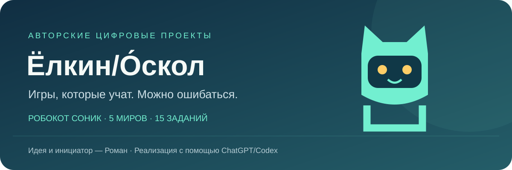

# Привет, я Роман — Ёлкин/О́скол 👋

Создаю полезные цифровые проекты и обучающие игры с помощью ChatGPT/Codex.

**[▶ Играть](https://elkin-oskol.github.io/-_-/) · [📱 Скачать Android](https://github.com/elkin-oskol/-_-/releases/latest) · [💬 Оставить отзыв](https://github.com/elkin-oskol/-_-/issues/new/choose)**

## Приключения робокота Соника

Обучающая 2D-игра для детей **6–9 лет**. Пять миров и 15 заданий: файлы, команды, текст, цифровая безопасность и рисование. Без регистрации и рекламы. После первой загрузки работает офлайн; APK содержит игру внутри.

  
  
  

Скриншоты и [короткое видео](https://elkin-oskol.github.io/-_-/media/game-demo.mp4) обновлены для **3.0.1**. Это браузерная запись с мобильными размерами экрана, не съёмка установленного APK.

## Для родителей

Начните с одного мира и помогайте ребёнку читать условия. Можно ошибаться и пользоваться подсказками. На телефоне движение — слева, прыжок и задание — справа; задание открывается рядом с терминалом.

Android **8.0+**. APK имеет отладочную подпись. Совместимость обновления зависит от ключа подписи. Прогресс хранится на устройстве; удаление приложения или очистка данных удаляет его. [Подробнее об установке и сохранениях](https://github.com/elkin-oskol/-_-#играть-и-установить).

## Сейчас в работе

- Собрать отзывы об управлении и сложности заданий.
- Проверить игру на разных Android-устройствах.
- Улучшить подсказки по результатам реальных отзывов.

[План развития](https://github.com/elkin-oskol/-_-/blob/main/GROWTH.md) · [Изменения](https://github.com/elkin-oskol/-_-/blob/main/docs/releases/3.0.1.md) · [Исходный код](https://github.com/elkin-oskol/-_-)

## Статистика проекта

Счётчик Downloads включает все файлы релизов, в том числе контрольные суммы. Это не число игроков или установок. [Показатели с датой проверки](https://github.com/elkin-oskol/-_-/blob/main/GROWTH.md#статистика).

## Обратная связь

[Ошибка](https://github.com/elkin-oskol/-_-/issues/new?template=bug.yml) · [Предложение](https://github.com/elkin-oskol/-_-/issues/new?template=idea.yml) · [Отзыв](https://github.com/elkin-oskol/-_-/issues/new?template=feedback.yml)

В отзывах не публикуйте имена, фотографии, контакты и другие личные данные детей.

Идея разработки и инициатор — **Ёлкин/О́скол**. Условия использования материалов указаны в [репозитории игры](https://github.com/elkin-oskol/-_-/blob/main/LICENSE).
